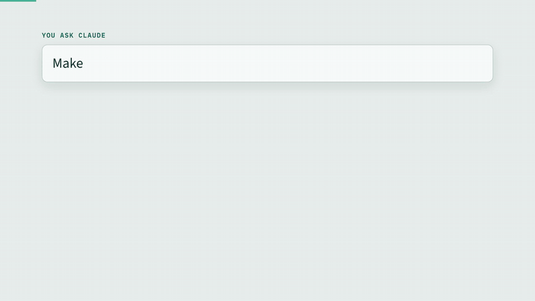

# Study Atlas

An agent skill for **Claude** and **OpenAI Codex** that turns course materials into one interactive, offline study app. The materials can be lecture slides, PDFs, notes or textbook chapters. If you have none, it can work from just a topic name.

[](docs/demo.mp4)

▶ **[Watch the full 1-minute demo (with sound)](docs/demo.mp4)**. It was built from a real 13-week Master's course on carbon markets and sustainable financing.

> "Make me a study atlas from the PDFs in this folder."
> "Make me a study atlas from the PDFs I upload here."
> "Make me a study atlas for Corporate Finance."

You get a single `.html` file that works with no internet and no install. Open it in any browser.

| Tab | What it does |
|---|---|
| **Mind map** | The whole course as a zoomable tree. **Recall mode** hides the labels, so you say each one aloud, reveal it, and mark whether you knew it. |
| **Study guide** | Condensed notes per unit, with exam traps, memory hooks and a "hide key terms" cloze mode. |
| **Flashcards** | Spaced repetition: a card retires after three correct answers. |
| **Practice test** | A timed mock exam, practice by unit, and a pile of the questions you got wrong. |
| **Highlights only** | Questions on just the text the materials put in bold, colour or highlight. |
| **Numbers only** | Every figure, date, threshold and worked result in the materials. |
| **Drills** | Put things in order, name a whole list, match pairs, sort items into categories, walk decision trees, and use calculators. |
| **Cheat sheet** | Numbers to memorise, easily confused pairs, threads across units, and errors or clashes in the source. |
| **Progress** | Per-unit scores, plus export and import of your progress. |

Every answer links to the page in your own PDF that it came from (`Source: W3 p26`). Progress saves in your browser.

## Install

### Claude Code: plugin (recommended)

```
/plugin marketplace add phanthanhdieulinh/study-atlas
/plugin install study-atlas@study-atlas
```

### Claude Code: copy the skill folder

```bash
git clone https://github.com/phanthanhdieulinh/study-atlas
cp -r study-atlas/skills/study-atlas ~/.claude/skills/
```

### Claude.ai (web or desktop app)

1. Download `study-atlas-skill.zip` from the [Releases](../../releases) page, or zip the `skills/study-atlas` folder yourself.
2. In Claude, go to **Settings → Capabilities → Skills** and upload it. Code execution must be on.
3. Upload your PDFs to a chat and ask for a study atlas.

### OpenAI Codex (CLI, IDE extension, app)

Codex reads the same `SKILL.md` format. Put the skill folder in your user skills directory, then restart Codex:

```bash
git clone https://github.com/phanthanhdieulinh/study-atlas
mkdir -p ~/.agents/skills
cp -r study-atlas/skills/study-atlas ~/.agents/skills/
```

On Windows, the folder is `%USERPROFILE%\.agents\skills\study-atlas`.

You can also ask Codex's built-in installer: `$skill-installer install the study-atlas skill from https://github.com/phanthanhdieulinh/study-atlas (folder skills/study-atlas)`.

To make it available to everyone working in one repo, copy it into that repo's `.agents/skills/` folder instead.

Use it by asking naturally ("make me a study atlas from the PDFs in this folder"), or call it directly with `$study-atlas`.

**Network:** Codex's default sandbox has no network, so `pip install pymupdf` may need your approval. You can also install it yourself first.

## Requirements

- **Python 3.9+** with `pip install pymupdf`, used to read PDFs.
- **Optional extras:** `python-pptx` for `.pptx` and `python-docx` for `.docx`. You can also export slides to PDF, which gives the best results.
- **For large courses:** the agent splits the writing across parallel subagents when the environment supports them (Claude Code does; Codex does when subagents are enabled). Otherwise it writes one unit at a time.
- **Images:** the agent must be able to view images, so it can read charts and diagrams on the slides. Claude Code, claude.ai and Codex all can.

## How it works

1. **Extract:** `scripts/extract.py` pulls page text, emphasised text (bold, colour, highlights), every sentence with a number, and renders of image-only slides.
2. **Write:** the agent reads every page and image and writes the guide, map, flashcards and questions as JSON. Every question cites its page. Coverage targets are in `references/writing-guide.md`.
3. **Check and build:** `scripts/validate.py` catches structural and quality problems. Then `scripts/build.py` assembles one self-contained HTML file from `assets/app.js` and `assets/style.css`.

To try the build without any materials:

```bash
python examples/demo-topic/make_demo.py
python skills/study-atlas/scripts/build.py examples/demo-topic demo.html
```

## Good to know

- **Keep the HTML next to the source files.** Source links are relative, so they only open from there. In Chrome and Edge they jump to the exact PDF page.
- **Topic-only mode is weaker.** It builds from public sources, not your course, so check it against your syllabus. Rebuild from your own slides when you have them.
- **Don't publish course materials or generated atlases.** They usually contain your institution's copyrighted content. The `.gitignore` already excludes PDFs, slides and generated atlases.

## Repository layout

```
.claude-plugin/          plugin + marketplace manifests (Claude Code)
AGENTS.md                notes for coding agents working on this repo
skills/study-atlas/
  SKILL.md               the method Claude follows
  scripts/               extract.py, validate.py, build.py
  assets/                app.js, style.css (the app; course-agnostic)
  references/            schema, writing guide, subagent brief, topic mode
  agents/openai.yaml     optional Codex / ChatGPT display metadata
examples/demo-topic/     a tiny 2-topic demo course
```

## License

MIT
